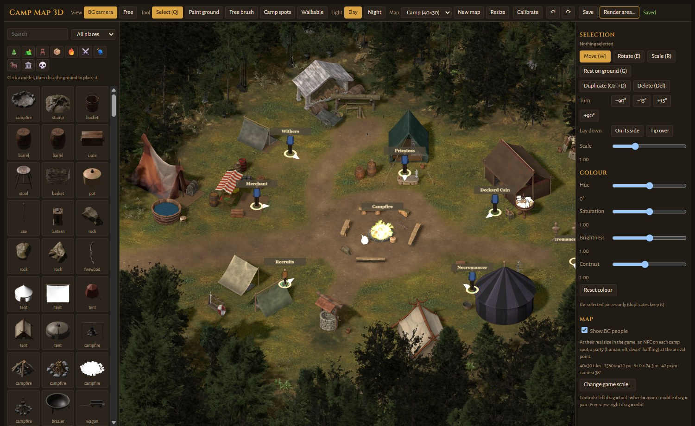
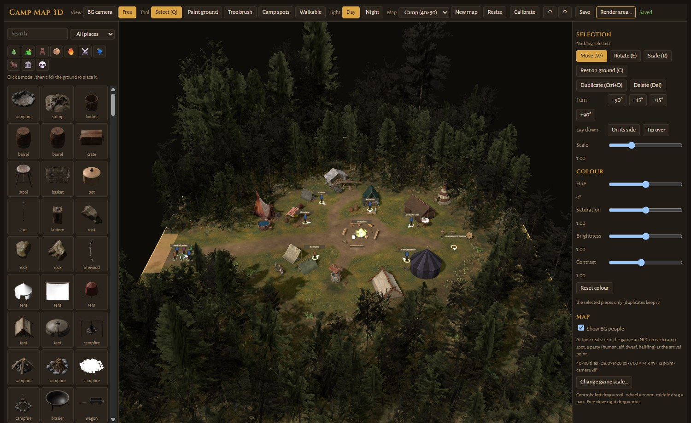

# MapSmithEE

Build new areas for the Infinity Engine games (Baldur's Gate EE, Siege of Dragonspear, Baldur's Gate II EE, EET) from a
3D layout: place models, paint the ground, plant forests, then render it in Blender at the game's camera angle and get a
playable area (ARE, TIS/PVRZ, WED, search/height/light maps) ready to drop into a game.



> **Early preview (0.1.0).** This is a very early version: the tool was made in about one day, the example camp
> included. It is rough around the edges, but it can evolve quickly, and I am very open to feedback and suggestions.
>
> The tool comes with models and textures from the community, plus a few AI-generated items that are not always
> polished or sorted. If you want to contribute models or textures, you are very welcome: see
> [CONTRIBUTING.md](CONTRIBUTING.md).
>
> A note on the model library: some props clearly lack polish. I haven't had the time to do better yet, so any help is
> very welcome, whether it's a better model, a texture, or a fix to an existing piece (an issue with a link and its
> licence is enough).

**Talk to me:** [GitHub Issues](https://github.com/sad0/MapSmithEE/issues) (bugs, suggestions, new models) ·
[Discussions](https://github.com/sad0/MapSmithEE/discussions) (ideas, questions, your maps) ·
[Discord](https://discord.gg/3XzeQv7HeS)

## What it does

- **3D layout in the game's view.** A "BG camera" with Baldur's Gate's exact angle and scale, next to a free 3D view.
  BG-sized characters stand on the map so you can judge sizes.
- **Hundreds of models** sorted in categories (nature, tents, furniture, supplies, fire and light, weapons, rugs,
  wagons and animals, buildings, remains), with search and a place filter.
- **Ground painting** with 29 textures (photo-scanned ones and Baldur's Gate-style ones), per-layer colour, your own
  colour variants, and a pipette.
- **Tree brush** to plant whole forests, **box selection** to move, turn, scale or recolour many pieces at once.
- **Game data:** arrival point, exits to the world map, walkable / blocked cells (automatic from the objects, then
  painted by hand), camp-fire animations.
- **Walls** that hide characters behind tents and trees, traced at the render, editable by hand, rebuilt in a second.
- **Day and night** lighting, in the editor and in the render.
- **Render area…** renders the map in Blender (day and night) and builds the playable area in one click.
- Undo / redo for everything, automatic saving.
- Ships with an example map, **Camp**.



## Install

1. Download `MapSmithEE_0.1.0_x64-setup.exe` from the [latest release](https://github.com/sad0/MapSmithEE/releases)
   and run it (Windows 10/11). Windows may warn that the app is not signed: *More info → Run anyway*.
2. To render areas, install [Blender](https://www.blender.org/download/) 5.x. MapSmithEE finds it by itself.
3. The first time you render, MapSmithEE downloads the full-quality models (about 2.6 GB, once).

Then follow the **[tutorial](docs/TUTORIAL.md)**: from the first look at the Camp to walking in your own area in the game.

## Thanks

- **Bubb**, for "Infinity Areas" and its feature list, which inspired the project
  (https://www.gibberlings3.net/forums/topic/38550-feedback-wanted-infinity-areas-tool-–-pre-alpha/).
  MapSmithEE is an independent implementation; it contains none of its code.
- Everyone who gave feedback in that thread.
- **IESDP** contributors, for documenting the Infinity Engine file formats (https://gibberlings3.github.io/iesdp/).
- **The Gibberlings Three** and **Beamdog forums** communities.
- **BioWare** and **Beamdog**, for the games and their art.
- **Acifer**, for the Baldur's Gate ground textures.
- **Gwendolyne**, for sharing the BG1 tree templates.
- **Poly Haven** and its artists, and every **Sketchfab / Objaverse** author whose model is in the library:
  each one is listed by name in [CREDITS.md](CREDITS.md).
- Open-source projects: **Tauri**, **Svelte**, **three.js**, **Blender**, **Rust** and their crates.

## Licences

- **MapSmithEE** (code, editor, example map): [CC BY-NC-SA 4.0](LICENSE). You may share and adapt it, with credit,
  for non-commercial use only, and anything you make from it must keep the same licence. Selling it, or a fork of it,
  is not allowed.
- **3D models and textures** keep their own licences, listed in [CREDITS.md](CREDITS.md) (CC0 and CC BY 4.0).
- **Baldur's Gate art** (BG1 tree cut-outs, Acifer's textures, the camp-fire animations) belongs to BioWare / Beamdog
  and is used as non-commercial fan content for the Infinity Engine games, as mods do. It is not covered by the
  licence above. If you are an author and want something removed, open an issue.

## Build from source

Needs Rust (stable) and Node.js 20+.

```
npm install
npm run tauri dev      # run
npm run tauri build    # Windows installer
```

The editor's preview models (`static/camp3d/models/`, 118 MB) are not in the repository: unzip
`mapsmithee-editor-models-0.1.0.zip` from the release into `static/camp3d/`.

The area editor (WED walls, ARE regions, actors, maps of existing areas) is in the code but hidden in this release:
it is not reliable enough yet.
