# MapSmithEE tutorial

From the first look at the example camp to walking in your own area in the game. MapSmithEE 0.1.0 (early preview).

1. [Install](#1-install)
2. [Look around](#2-look-around)
3. [Maps](#3-maps)
4. [Place models](#4-place-models)
5. [Select and edit](#5-select-and-edit)
6. [Many pieces at once](#6-many-pieces-at-once)
7. [Paint the ground](#7-paint-the-ground)
8. [Plant trees](#8-plant-trees)
9. [Arrival point and exits](#9-arrival-point-and-exits)
10. [Walkable cells](#10-walkable-cells)
11. [Walls](#11-walls)
12. [Day and night](#12-day-and-night)
13. [Render the area](#13-render-the-area)
14. [Play it in the game](#14-play-it-in-the-game)
15. [Shortcuts](#15-shortcuts)
16. [Troubleshooting](#16-troubleshooting)

## 1. Install

1. Download `MapSmithEE_0.1.0_x64-setup.exe` from the [releases page](https://github.com/sad0/MapSmithEE/releases) and
   run it. The app is not signed, so Windows may show a blue warning: *More info → Run anyway*.
2. Install [Blender](https://www.blender.org/download/) 5.x (only needed to render). MapSmithEE looks for it in the usual
   install folders.
3. Start MapSmithEE. It opens on **Camp**, the example map.

Your maps are saved automatically in the app's data folder. Rendered areas go to `Documents\MapSmithEE\<area name>`.

## 2. Look around

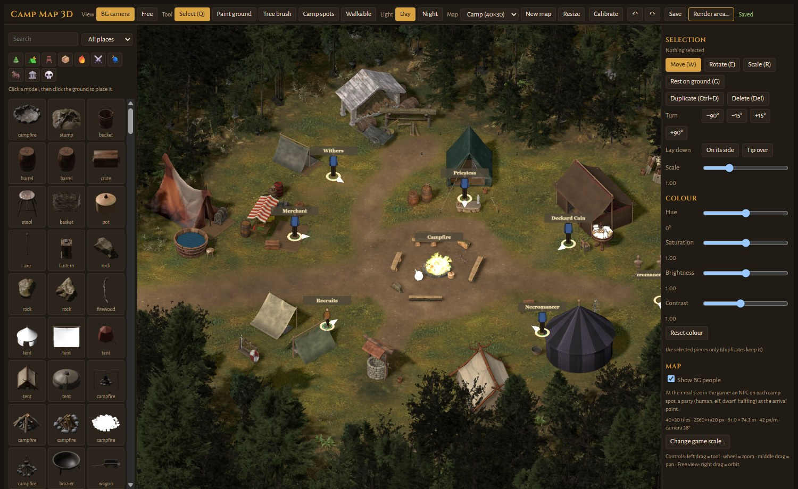

The screen has three parts: the **model palette** on the left, the **map** in the middle, the **settings** of the current
tool on the right. The top bar holds the view, the tools, the light, the map list, undo / redo and **Render area…**.

- **BG camera** shows the map exactly as the game will: the same 38° angle, the same scale. The small blue, green and
  brown people are real-size game characters (*Show BG people* in the Map panel turns them on and off).
- **Mouse:** wheel = zoom (towards the cursor), middle drag = pan, left drag = the current tool.

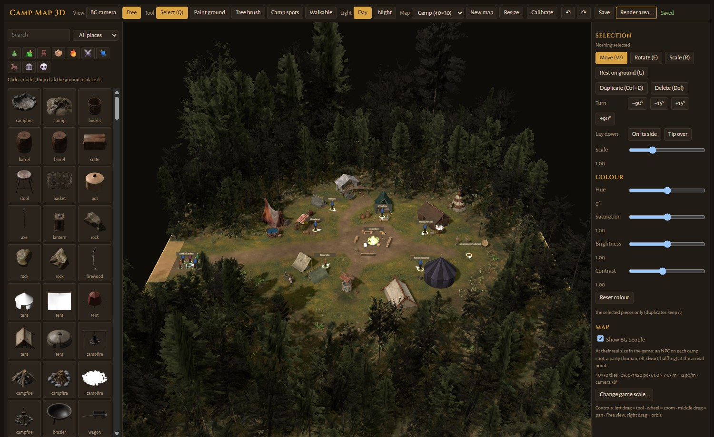

- **Free** is a free 3D camera: right drag = orbit, middle drag = pan, wheel = zoom. Handy to check heights and hidden
  pieces. The render always uses the BG camera.

## 3. Maps

- The **Map** list switches between your maps.
- **New map** asks for a name and a size in tiles (64×64 game pixels each): small 30×22, medium 40×30, large 60×45,
  huge 80×60. The ground starts as grass.
- **Resize** changes the size of the current map; tick the sides that grow (or shrink).
- **Change game scale…** (bottom of the Map panel) sets how many game pixels a metre is. Leave it at 42 px/m unless you
  know why: it changes the size of everything next to the game's characters.

## 4. Place models

The palette lists every model as a picture.

- The **category buttons** (tree, tents, furniture, supplies, fire and light, weapons, rugs, wagons and animals,
  buildings, remains) filter the list; click again to see everything.
- **All places** filters by where a thing is usually found (camp, town, nature, temple, dungeon...).
- **Search** finds a model by name; it stays on top while the list scrolls.

Click a model, then click the ground to place it. Hold **Shift** to place several copies in a row. **Esc** stops.

### Your own models and sprites

**Import…** under the category buttons adds your own pieces to the tray (they show with a dashed frame):

- **3D model**: any format Blender reads (glTF / GLB, OBJ, FBX, STL, DAE, USD, PLY, Alembic, X3D, .blend). Blender
  converts it, stands it on the ground and makes a light copy for the editor (it takes up to a minute). Give its
  **Height** in metres, or leave it empty to keep the model's own size (a model made in centimetres is detected).
- **2D sprite**: a transparent PNG drawn at BG's angle and pixel size, or a frame of a BAM. It stands like BG's own
  trees, facing the camera, at its size in game pixels. A `<name>_shadow.png` next to the PNG becomes its shadow on the
  ground.

**Type** sets its category in the tray (and makes a campfire, brazier or lantern light the night). Right-click one of
your pieces in the tray to delete it. Your imports live in MapSmithEE's own folder
(`%APPDATA%\com.sad0.mapsmithee\userlib`) and every map can use them.

## 5. Select and edit

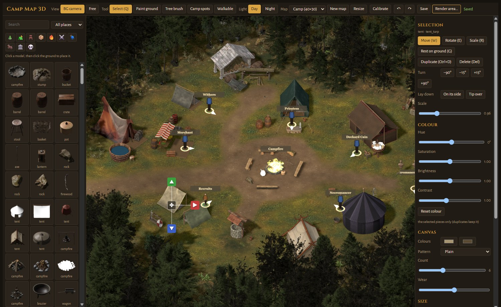

With **Select (Q)**, click a piece. Clicking the same spot again picks the piece below (stacked pieces).

- **Move (W), Rotate (E), Scale (R)** switch the gizmo. In the BG camera, Move shows four handles: ▲ height, ▼ depth
  (towards / away from the camera), ▶ left / right, ✥ slide on the ground.
- **Rest on ground (G)** drops the piece onto the ground.
- **Turn** −90°, −15°, +15°, +90° and **Lay down** (on its side, tip over).
- **Scale** slider, and **Colour**: hue, saturation, brightness, contrast for this piece only.
- **Duplicate (Ctrl+D)** and **Delete (Del)**.
- Tents and rugs also have a **Canvas** panel: two colours, a pattern (stripes, bands, checks, chevrons, border,
  medallion, kilim, diamonds), how many stripes, wear, and width / depth / height.
- A **camp fire flame** is the game's own animation: its size picks small, medium or large.

## 6. Many pieces at once

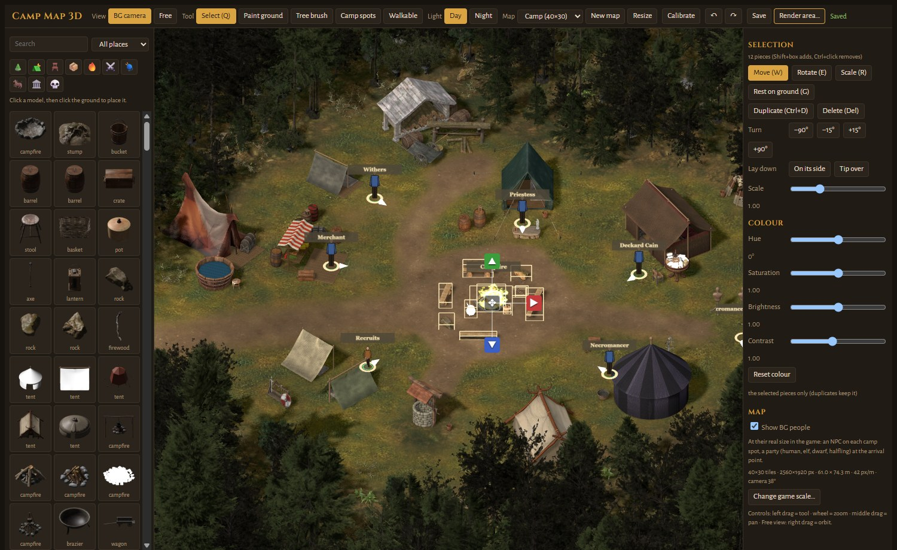

In **Select**, drag a box from empty ground: every piece and camp spot whose foot is inside is selected (each one gets a
yellow outline).

- **Shift + box** or **Shift + click** adds to the selection, **Ctrl + click** removes a piece.
- The gizmo then moves, turns and scales the whole group around its centre. People turn with it.
- **Scale**, **Colour**, **Rest on ground**, **Duplicate** and **Delete** apply to every selected piece.
  (Duplicate and Delete leave the camp spots alone: each spot is one person.)

## 7. Paint the ground

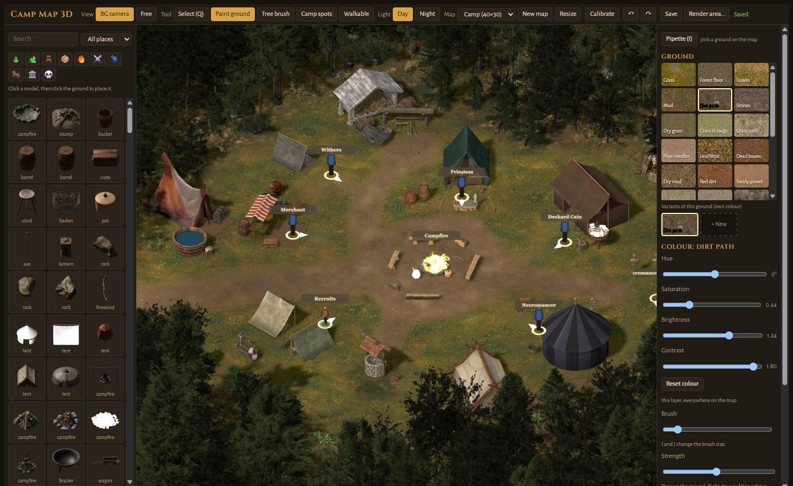

**Paint ground**, pick a texture, and drag on the map. Each texture is a layer; a layer painted later covers the earlier
ones.

- **Brush** size (or the **[** and **]** keys) and **Strength**. The yellow ring shows the brush.
- **Colour** changes a layer's hue, saturation, brightness and contrast **everywhere on the map**.
- **Variants:** under the texture grid, the second row shows the chosen ground, its variants and **+ New**. **+ New**
  makes *Dirt path 2*, *Dirt path 3*... a copy of the ground with its own colour, so you can have a dark path and a light
  path on the same map.
- **Pipette (I)** (top of the panel): click the map to pick the ground painted there, variant included; the brush goes on
  with it.
- **Ctrl+Z / Ctrl+Y** undo and redo strokes and colour changes too.

### Your own textures

**Import texture…** under the ground textures adds a picture as a new ground. It is tiled over the map, so use a
seamless one (2048 px at most are kept). The editor reloads to add it to the list.

## 8. Plant trees

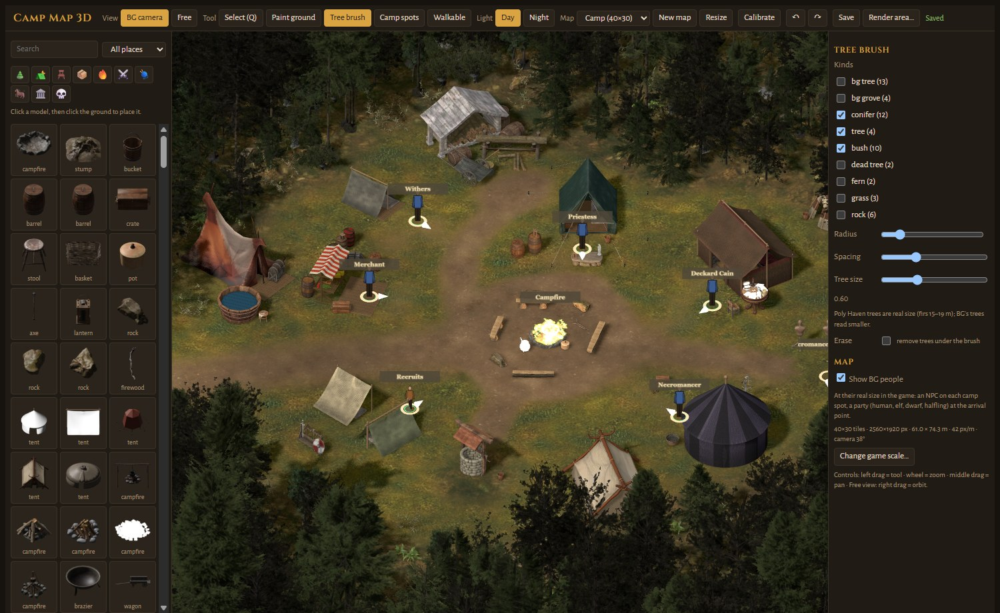

**Tree brush** plants trees where you drag.

- **Kinds:** tick the kinds of trees and plants to mix (the BG1 trees look most like the game).
- **Radius**, **Spacing** (the smallest gap between two trees) and **Tree size**.
- **Erase** removes the trees under the brush.

Trees are ordinary pieces: select them, move them, delete them like any other.

## 9. Arrival point and exits

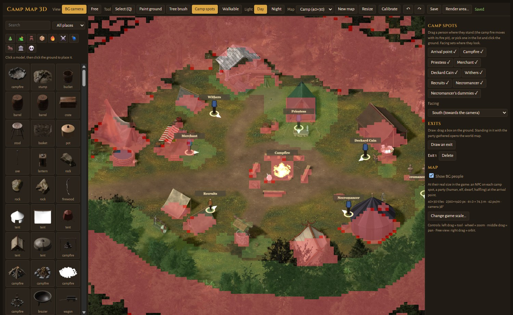

**Camp spots** places the game's points:

- **Arrival point**: where the party appears when it enters the area (the game's entrance "Entry"). Drag it, or pick it
  in the list and click the ground. **Facing** sets where people look.
- The other spots (Priestess, Merchant, Withers...) belong to the SadoQoL rest camp. In a new area they are only
  markers; leave them or ignore them.
- **Draw an exit**, then drag a box on the ground: standing in it with the whole party opens the world map.

## 10. Walkable cells

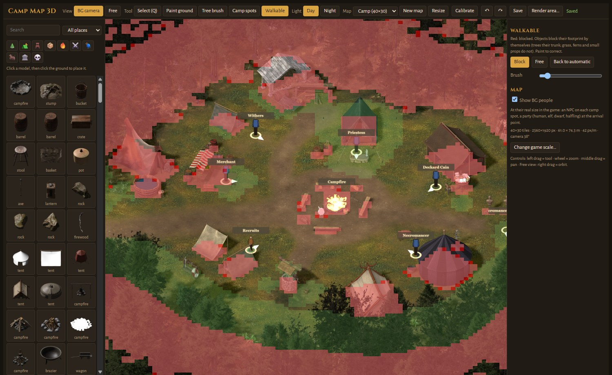

**Walkable** shows the game's search map: red cells are blocked, the rest is walkable. Objects block their own footprint
(trees their trunk; grass, ferns and small props do not).

- **Block** and **Free** paint corrections; **Back to automatic** erases them.
- Keep the arrival point and the exits on walkable ground.

## 11. Walls

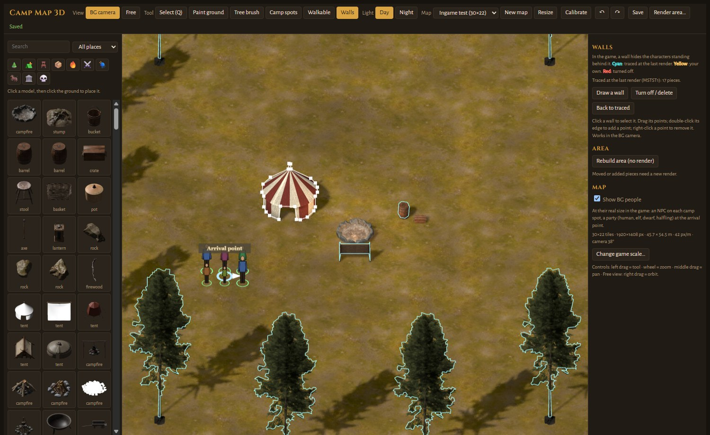

In the game, a **wall** hides the characters standing behind a piece: a tent, a tree, a wagon. MapSmithEE traces one
around each piece when it renders the area. The rule is simple: a character whose feet are **lower** on the screen than
the bottom of the piece walks **in front** of it; higher up, **behind** it.

**Walls** (top bar, BG camera) shows them over the map: **cyan** = traced at the last render, **yellow** = your own,
**red** = turned off.

- Click a wall to select it. Drag its points; double-click its edge to add a point; right-click a point to remove it.
  The piece's wall then becomes yours and follows the piece when you move it.
- **Turn off / delete** (or **Del**): the piece hides nobody (or your drawn wall goes away).
- **Back to traced**: forget your edit.
- **Draw a wall**: click points on the map, then click the first one or press **Enter**. For something the render cannot
  know, such as a rock face painted on the ground.
- **Rebuild area (no render)** rebuilds the area in a second with your walls, spots, exits and walkable cells, from the
  last render's pictures. Moved or added pieces need a new render.

## 12. Day and night

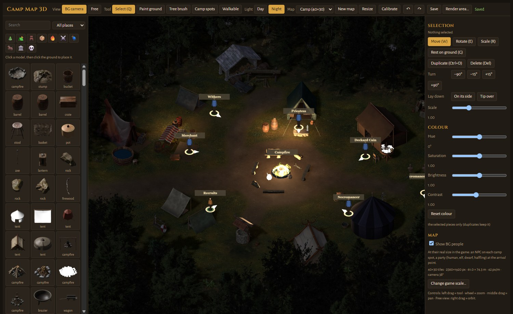

**Day** and **Night** in the top bar switch the light. Fires, braziers, lanterns and torches light their surroundings at
night. The render makes both versions (the game switches between them by itself).

## 13. Render the area

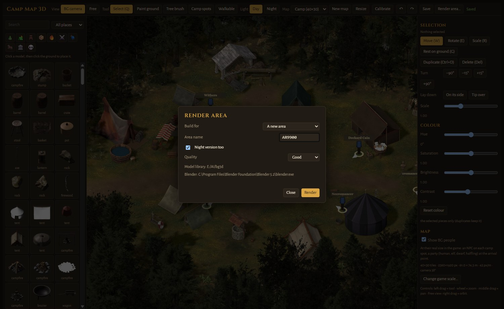

Click **Render area…**.

1. The first time, click **Download models**: about 2.6 GB of full-quality models, once. The download resumes if it is
   cut.
2. **Area name**: exactly 6 characters, letters and digits (for example `AR9900`). Pick a name no other area or mod
   uses: the game knows areas only by this name.
3. **Night version too**: renders the night picture as well.
4. **Quality**: *Draft* is fast, for checking; *Good* for playing; *Final* for a release.
5. **Render**. The bar shows the steps: loading models, the day and night pictures, then the area build. Blender works
   in the background; **Stop** cancels.

The first render prepares every model and keeps them in a cache, so it is the slowest one (around 15–20 minutes for the
Camp at Good quality); the next ones are faster.

The result is in `Documents\MapSmithEE\AR9900`:

| File | What it is |
| --- | --- |
| `AR9900.ARE` | the area: entrance, exits, fire animations, flags |
| `AR9900.TIS` + `A990000.PVRZ`... | the day picture, cut in tiles |
| `AR9900N.TIS` + `A9900N00.PVRZ`... | the night picture |
| `AR9900.WED`, `AR9900N.WED` | the walls (what hides characters behind trees and tents) |
| `AR9900SR.BMP` | search map (walkable cells) |
| `AR9900HT.BMP`, `AR9900LM.BMP`, `AR9900LN.BMP` | height map, day and night light maps |
| `preview.jpg` | the render with walls (cyan), blocked cells (red), exits and spots drawn on it |
| `HOW_TO_TEST.txt` | how to try the area in the game, with its console line |

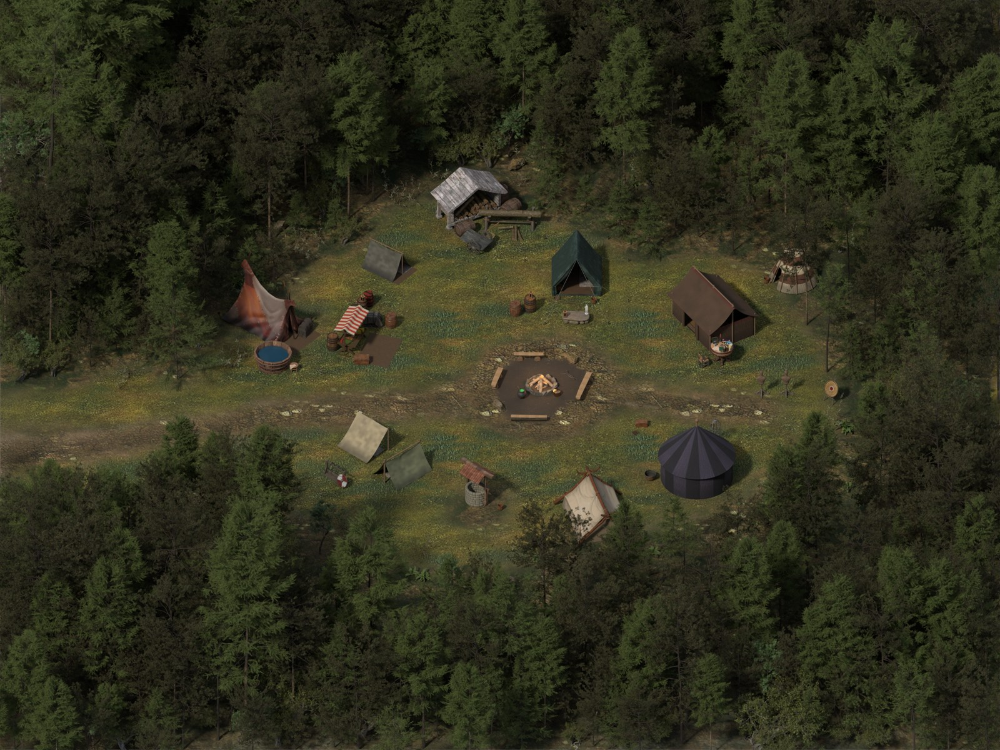

### Export the scene

**Export scene…** saves the scene Blender renders (the BG camera, the sun and fires of the hour, the painted ground,
every piece) to open in another 3D program:

- **Blender (.blend)**: everything, textures packed in, ready to render as MapSmithEE does.
- **glTF (.glb)** and **FBX (.fbx)**: for other programs and engines. The painted ground is baked into one picture;
  pieces keep their textures but not their own colour, and BG sprite shadows come out solid.

A big map makes big files (the Camp: about 2 GB) and a glTF export can take a while.

## 14. Play it in the game

When the render ends, the dialog shows a console line for your area, and the area folder holds the same steps in
`HOW_TO_TEST.txt`.

1. Copy every file of the area folder **except `preview.jpg` and `HOW_TO_TEST.txt`** into the game's `override` folder
   (for example `Baldur's Gate Enhanced Edition\override`). Better on a copy of the game, or with a mod manager.
2. Turn the console on: in `Baldur.lua` (in `Documents\Baldur's Gate - Enhanced Edition`), set
   `SetPrivateProfileString('Program Options','Debug Mode','1')`.
3. Load a game, select the whole party, press **Ctrl+Space** and type the line from the dialog, for example:

   ```
   C:MoveToArea("AR9900")
   ```

   The selected characters are taken to your area (the game picks where they land).
4. Walk into an exit with the whole party to go back to the world map.

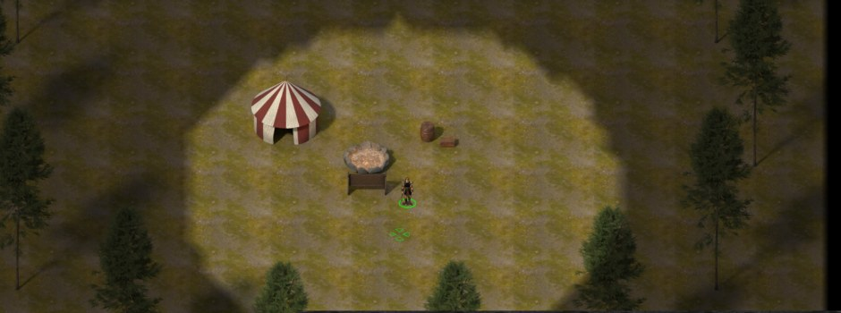

The new area is not on the world map. To make it part of a mod, link to it with your mod's tools (a world map entry, or
a script or dialogue that uses `LeaveAreaLUA`).

## 15. Shortcuts

| Key | Action |
| --- | --- |
| Q | Select tool |
| W / E / R | Move / Rotate / Scale gizmo |
| G | Rest on ground |
| Ctrl+D / Del | Duplicate / Delete the selection |
| Shift + click or box | Add to the selection |
| Ctrl + click | Remove from the selection |
| I | Pipette (ground) |
| [ / ] | Brush smaller / bigger |
| Ctrl+Z / Ctrl+Y | Undo / Redo |
| Esc | Deselect, stop placing, cancel the pipette |

## 16. Troubleshooting

- **"Blender 5.x is needed"**: install Blender 5.x from blender.org, then reopen the Render dialog.
- **The model download stopped**: click **Download models** again; it resumes where it stopped.
- **The render is slow**: the first one fills the model cache; try *Draft* while you work on the layout.
- **Characters walk through things / get stuck**: check **Walkable** and paint the corrections.
- **Something else**: open an [issue](https://github.com/sad0/MapSmithEE/issues) with a screenshot, or ask on the
  [Discord](https://discord.gg/3XzeQv7HeS).
